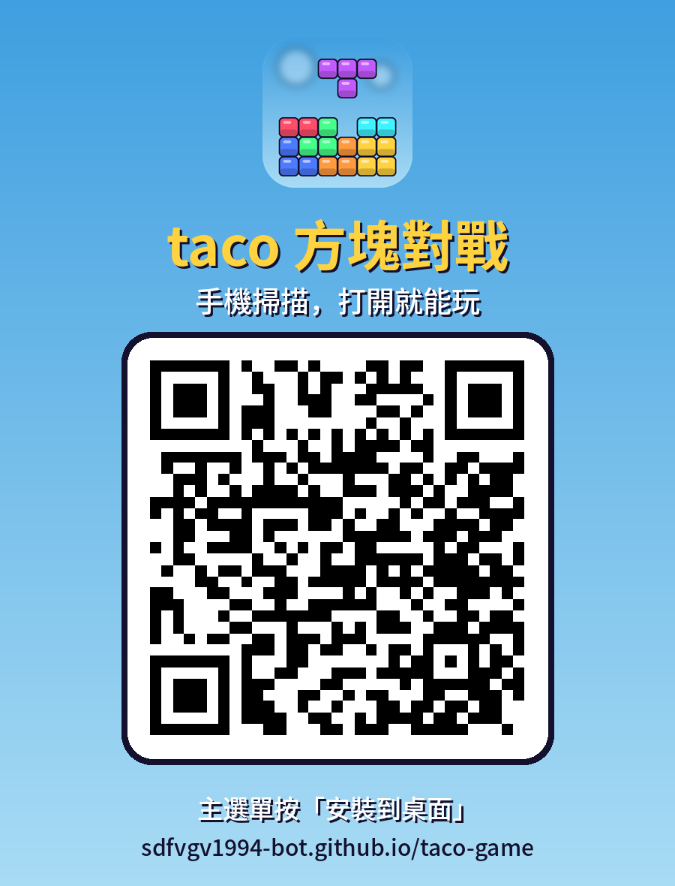

# taco-game

小遊戲合集（從 [taco0525](https://github.com/sdfvgv1994-bot/taco0525) 分出來，股市程式留在那邊）。

| 資料夾 | 內容 | 執行 |
| --- | --- | --- |
| [`snake/`](snake/) | 貪食蛇 | 雙擊 `啟動貪食蛇.bat`，或 `python snake/snake.py` |
| [`kaleidoscope/`](kaleidoscope/) | 萬花筒畫板 | 雙擊 `啟動萬花筒.bat`，或 `python kaleidoscope/kaleidoscope.py` |
| [`tetris/`](tetris/) | 俄羅斯方塊對戰（雙人 / 對電腦） | 雙擊 `啟動俄羅斯方塊.bat`，或 `python tetris/tetris.py` |

## 網頁版：taco 方塊對戰

**https://sdfvgv1994-bot.github.io/taco-game/** ，手機、電腦打開就能玩，不用安裝也不用登入。

- 模式：KO 對戰、分數對戰、攻擊對戰、生死戰、Sprint 40、Marathon；可以對電腦，或兩個人用同一台
- **裝到手機桌面**：打開網址後，主選單按「📲 安裝到桌面」（Android 的 Chrome、Edge）；iPhone 用 Safari 的「分享 → 加入主畫面」。
  裝好之後是全螢幕、沒有網址列，沒網路也能玩單機和對電腦，更新會自動跟上
- 分享給朋友：[QR code 卡片](web/app/share-qr.png)

  
- **線上對戰**：一個人「建立房間」拿到 4 位數房號，朋友打開同一個網址、輸入房號就能連線對打。
  連線用 [PeerJS](https://peerjs.com/)，兩台裝置直接互連，不經過我們的伺服器。
  少數公司或學校的網路會擋這種直連，連不上時換手機網路試試。
- 程式在 [`web/`](web/)：`index.html` 是畫面骨架、`style.css` 是樣式，`js/` 依載入順序分成
  `engine`（規則）、`ai`（電腦對手）、`settings`（設定與按鍵）、`audio`（聲音）、`draw`（畫面）、`state`（遊戲狀態）、
  `panels`（選單與結算）、`input`（鍵盤與觸控）、`net`（線上對戰）、`main`（主迴圈）；`web/music/` 是背景音樂（來源標在遊戲的設定畫面）
- main 分支的 `web/` 有改動時，GitHub Actions「網頁版上線」會自動更新網站

Windows 的 `.bat` 啟動檔出錯時，視窗會停住顯示錯誤訊息，也會記在 `.cache\` 裡的 `*_log.txt`。

## 安裝

```bash
python -m venv .venv
# Windows: .venv\Scripts\activate    macOS / Linux: source .venv/bin/activate
pip install -r requirements.txt
```

## 自動更新
每個遊戲啟動時會先檢查 GitHub 上有沒有新版，有的話自動更新、套件有變就自動安裝，再用新版重新啟動
（和 taco0525 同一套，程式在 `common/updater.py`）。本機改過的程式碼會先備份到 `.cache/backup/`；
最高分、存下來的圖不在 git 裡，不會被動到。不想更新可以設環境變數 `TACO_NO_UPDATE=1`。

## 測試

```bash
python -m pytest tests
```
